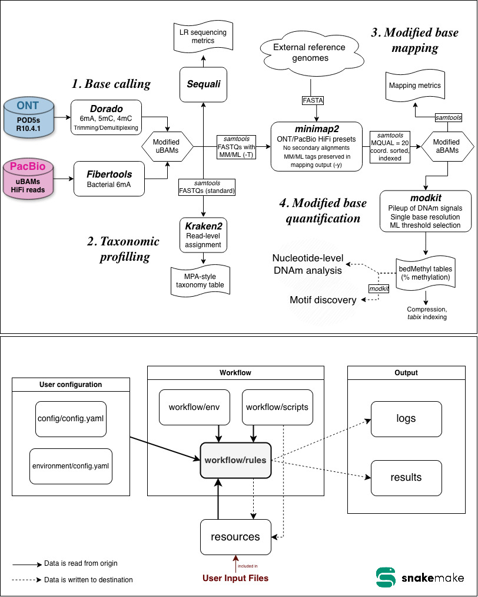

# methbiome

<center>Bioinformatic pipeline for reference-guided epigenetic analysis of long-read microbiomes. <em>methbiome</em> reads in electrical signal data from ONT stored in POD5 files alongside kinetic feature data from PacBio HiFi reads in BAM format. <em>methbiome</em> performs <em>1)</em> base calling and data quality assessment, <em>2)</em> taxonomic profiling, <em>3)</em> modified base mapping, and <em>4)</em> modified base quantification. <em>methbiome</em>'s reference-guided approach quantifies DNA methylation within a stable, accurate coordinate system, enabling robust epigenetic profiling across loci, samples, and studies, and supporting downstream meta-epigenome-wide association and methylation motif analyses. <em>methbiome</em> was implemented in <em>Snakemake</em>.   </center>
<br><br>



<br><br>

## Table of Contents

- [methbiome](#methbiome)
  - [Table of Contents](#table-of-contents)
  - [I. Demo](#i-demo)
    - [A. Google Colab Notebook](#a-google-colab-notebook)
    - [B. Test Data](#b-test-data)
  - [II. Environment Dependencies](#ii-environment-dependencies)
    - [A. Operating Systems](#a-operating-systems)
    - [B. Execution Profiles](#b-execution-profiles)
    - [C. Dorado](#c-dorado)
    - [D. Kraken2 Database](#d-kraken2-database)
  - [III. Set Up](#iii-set-up)
    - [A. Miniforge](#a-miniforge)
    - [B. Snakemake](#b-snakemake)
    - [C. Slurm Plugin](#c-slurm-plugin)
    - [D. What Happens On The First Run](#d-what-happens-on-the-first-run)
  - [IV. Usage](#iv-usage)
    - [A. Download methbiome](#a-download-methbiome)
    - [B. Configuration](#b-configuration)
    - [C. Pipeline Execution](#c-pipeline-execution)
      - [1. Parallel Processing Set Up](#1-parallel-processing-set-up)
      - [2. Execution of the Entire Pipeline](#2-execution-of-the-entire-pipeline)
      - [3. Execution of Part of the Pipeline](#3-execution-of-part-of-the-pipeline)
    - [D. Debugging](#d-debugging)
    - [E. Outputs](#e-outputs)
    - [F. Post-run Scripts](#f-post-run-scripts)
      - [1. Combine Sequali Reports into MultiQC](#1-combine-sequali-reports-into-multiqc)
      - [2. Combine MPA Reports](#2-combine-mpa-reports)
      - [3. Combine Kraken2 Reports into Krona](#3-combine-kraken2-reports-into-krona)
      - [4. Plot Methylation Over a Region](#4-plot-methylation-over-a-region)

## I. Demo

### A. Google Colab Notebook

You can try methbiome by running the [Google Colab notebook](https://colab.research.google.com/drive/15uYQdcTwluXYcr8-edEkCZE-qLVAQ9Lc). Everything is set up for you, and the 'smaller datasets' described below are used.

### B. Test Data

The pipeline was tested using publicly available data for the ZymoBIOMICS D6323 fecal microbiome standard. ONT POD5s available at https://epi2me.nanoporetech.com/zymo_fecal_2025.05/. PacBio BAMs available at https://www.pacb.com/connect/datasets/.

Smaller datasets that can be run on a laptop are available [here](https://drive.google.com/drive/folders/1YiXczjeheY9dg6TtVhGydqKJDlDBXjtT)

## II. Environment Dependencies

### A. Operating Systems

Linux x64 and macOS are supported. The pipeline targets SLURM clusters and has also been run end to end with the local profile on macOS, and on Google Colab.

### B. Execution Profiles

Three Snakemake profiles are provided in [`profiles/`](profiles):

| Profile | Use for |
| --- | --- |
| [`profiles/slurm`](profiles/slurm/config.yaml) | Execution on a SLURM cluster (the default target of this pipeline). |
| [`profiles/local`](profiles/local/config.yaml) | Execution on a single machine (e.g. laptop). |
| [`profiles/google_colab`](profiles/google_colab/config.yaml) | Execution on a Google Colab notebook. |

Each profile sets the executor, the number of parallel jobs, software deployment (conda) and the per-rule resources (partition, memory, CPUs, runtime). Pick one with `--profile profiles/<name>`. To support another scheduler, copy a profile and edit the copy: [`profiles/slurm/config.yaml`](profiles/slurm/config.yaml) links to some documentation.

### C. Dorado

Dorado is not installed with conda. If `input_files.dorado.archive.path` is `null` in your configuration file, the `install_dorado` rule downloads the **Linux x64** build. This happens even for a PacBio run, so set the path to any unpacked Dorado if you do not want that download.

For any other platform, download Dorado yourself from [Oxford Nanopore](https://dorado-docs.readthedocs.io/en/latest/), unpack it, and set `input_files.dorado.archive.path` to the unpacked directory. The pipeline expects the binary at `<that directory>/bin/dorado`. For example, on an Apple Silicon Mac:

```yaml
input_files:
    dorado:
        archive:
            path: /path/to/dorado-2.1.1-osx-arm64
```

### D. Kraken2 Database

If `input_files.kraken2.database.path` is `null`, the `install_kraken2_db` rule downloads the latest Kraken2 **Standard** database into `resources/assets/Kraken2DB`.

Any other database can be downloaded separately and used by setting `input_files.kraken2.database.path` to the unpacked directory.

## III. Set Up

You do not have to install any of the tools methbiome uses, as it automatically manages its dependencies.

| Installed by | What |
| --- | --- |
| **You**, once, before starting | `conda`, `snakemake`, the SLURM executor plugin if you run on SLURM. |
| **Snakemake**, automatically, on the first run | dorado, fibertools-rs, kraken2... |


### A. Miniforge

Install [miniforge](https://conda-forge.org/download). It provides the `conda` command Snakemake uses to build the tool environment, so make sure `conda` is on your `PATH` on the machine you launch Snakemake from — on SLURM that is the login node, not the compute node.

### B. Snakemake

See [Snakemake installation](https://snakemake.readthedocs.io/en/stable/getting_started/installation.html). Snakemake needs to be installed with conda, or in a Python environment that can reach `conda`, so that it can deploy the tools for you.

### C. Slurm Plugin

Only needed when you execute on SLURM:

```bash
pip install snakemake-executor-plugin-slurm
```

Install it into the same environment `snakemake` itself lives in.

### D. What Happens On The First Run

The first rule that needs a tool triggers the environment build: Snakemake resolves `workflow/envs/main.yaml`, downloads the packages and caches the result under `.snakemake/conda/`. This happens before any analysis, so expect the first command to spend a while downloading, and allow a few gigabytes of disk space for the cache. All rules share this one environment and the cache is reused by every later run, so you pay the cost once per copy of the project rather than once per run.

The packages are downloaded again if the environment is ever rebuilt, for example after you change `workflow/envs/main.yaml` or move the project to another directory or machine. Delete `.snakemake/conda/` to start from a clean slate.

## IV. Usage

### A. Download methbiome

```bash
git clone https://github.com/ricardocosteira/methbiome
```

### B. Configuration

One configuration file describes **one run**, which is one directory of ONT POD5 files or one directory of PacBio BAM files.

1. Make a copy of [`config/template.yaml`](config/template.yaml) in `config/` and name it after the run, for example `config/run1.yaml`. Do not edit `config/template.yaml` itself, so that it stays available as a template.
2. Set the values listed below. Before any rule runs, `snakemake` validates the file against [`config/schema/config.schema.yaml`](config/schema/config.schema.yaml) and checks that every path and file you point at exists, so a typo is reported straight away.

| Key | Values | Meaning |
| --- | --- | --- |
| `input_files.data.dir.path` | path, no trailing `/` | Directory of the run's `.pod5` or `.bam` files. |
| `input_files.data.dir.custom_path` | `true` / `false` | Use the path as-is, or under `resources/data`. |
| `input_files.data.type` | `ONT` / `PacBio` | Platform of the input. |
| `input_files.minimap2.custom_references_dir` | path / `null` | Where references and indices live; `null` uses `resources/references`. |
| `input_files.minimap2.default_reference_filename` | `*.fasta` / `*.fna` | Reference for the whole run. |
| `input_files.minimap2.default_index_filename` | `*.fai` / `null` | Reference index, needed above 4 GB; `null` if there is none. |
| `input_files.minimap2.multi_reference_filename` | `name: *.fasta` / `null` | Extra per-barcode references; `null` maps everything to the default. |
| `input_files.minimap2.multi_index_filename` | `name: *.fai` / `null` | Extra per-barcode indices; `null` uses the default index. |
| `input_files.kraken2.database.path` | path / `null` | Existing Kraken2 database; `null` downloads the latest Standard one. |
| `input_files.dorado.archive.path` | path / `null` | Existing Dorado installation; `null` downloads the Linux x64 build. |
| `tabix` | `true` / `false` | bgzip and index the bedMethyl files. |
| `output_name` | non-empty string | Names the run's output and log directories. |
| `tool_specific_params.dorado.min_quality` | integer ≥ 0 | Minimum basecall quality to keep. |
| `tool_specific_params.dorado.trim` | `--trim all` / `--no-trim` | Whether to trim reads. |
| `tool_specific_params.dorado.methylation_model` | e.g. `hac,4mC_5mC,6mA` | Models that call modifications. |
| `tool_specific_params.dorado.demultiplexing` | `true` / `false` | Whether to split reads by barcode. |
| `tool_specific_params.dorado.mux_barcode_kit` | e.g. `SQK-NBD114-24` | Barcode kit, needed when demultiplexing. |
| `tool_specific_params.dorado.valid_file_size` | `<int>[cwbkMG]`, e.g. `1G` | Smallest demultiplexed BAM to carry on. |
| `tool_specific_params.minimap2.mapping_quality` | integer ≥ 0 | Minimum MAPQ to keep. |
| `tool_specific_params.minimap2.max_target_bases` | `<int>[cwbkMG]` / `null` | minimap2 `-I`. |
| `tool_specific_params.minimap2.minimum_window_size` | integer / `null` | minimap2 `-w`. |
| `tool_specific_params.modkit.minimum_methylation_likelihood` | `0` to `1` | modkit `--filter-threshold`. |

Multi-reference mapping is for a run whose barcodes or samples belong to different genomes: list them in `multi_reference_filename` as `name: file` pairs, where `name` is a string to find in the input file name and `file` is a reference in the references directory, and give their `.fai` files in `multi_index_filename`. Any input matching no name is mapped to the default reference and index.

The section below those keys in `config/template.yaml` is generated from them. Do not edit it.

To run several samples, write one configuration file per sample. They can all be processed in parallel; see [Parallel Processing Set Up](#1-parallel-processing-set-up).

### C. Pipeline Execution

#### 1. Parallel Processing Set Up

Dependencies have to be installed first for parallel processing of samples. This has to be done before processing any sample:

```bash
snakemake setup --profile profiles/your_profile --configfile config/run1.yaml
```

#### 2. Execution of the Entire Pipeline

Open a `tmux` session so that Snakemake keeps running when you disconnect, then run the pipeline with the configuration file of the run you want to process:

```bash
snakemake --profile profiles/your_profile --configfile config/run1.yaml
```

#### 3. Execution of Part of the Pipeline

Replace `rule_name` in the command below and run it:

```bash
snakemake rule_name --profile profiles/your_profile --configfile config/run1.yaml
```

This runs the pipeline up to `rule_name`, meaning every rule `rule_name` depends on is executed as well.

### D. Debugging

If a rule fails, look at the rule's log in `logs/rules/<output_name>/` (and `logs/cluster/` if appropriate). For the input-validation step, methbiome also prints the first ten lines of that log to the terminal whenever it is not empty, so you see unreadable POD5 or BAM files straight away.

### E. Outputs

The results from the pipeline are written to `results/<output_name>/`, and the log of each rule to `logs/rules/<output_name>/` (SLURM job logs additionally go to `logs/cluster/`).

| Directory | Contents |
| --- | --- |
| `<output_name>_bam/` | Basecalled BAMs with modified-base tags (ONT) or BAMs with kinetic modifications called (PacBio). |
| `<output_name>_bam_invalid/` | Barcodes discarded by Dorado demultiplexing, if enabled. |
| `<output_name>_fastq_gz/` | Basecalled reads as compressed FASTQ. |
| `sequali_<output_name>/` | Sequali quality reports, one `.html` and one `.json` per input file. |
| `kraken2_<output_name>/` | Kraken2 assignments (`.kraken2`), reports (`.kreport2`) and multi-sample-ready reports (`.kreport2.mpa`). |
| `minimap2_<output_name>_filtered/` | Sorted, quality-filtered BAMs with their indexes, `.flagstat` and `.coverage` files. |
| `modkit_<output_name>/` | bedMethyl files with per-base modification frequencies. Kept only if `tabix: false`, because it is the input of the next step. |
| `tabix_<output_name>/` | The bedMethyl files from above, bgzipped and indexed (only if `tabix: true`). |

### F. Post-run Scripts

These scripts combine the output of several runs and automatically manage all required dependencies, so here again there is nothing for you to install.
Run them from the `post-run` directory:

```bash
cd post-run
```

#### 1. Combine Sequali Reports into MultiQC

Where `<directory1>`, `<directory2>`, ... are directories containing Sequali reports:

```bash
./combine_sequali_into_multiqc.sh <directory1> <directory2> <directoryn>
```

#### 2. Combine MPA Reports

Where `<directory1>`, `<directory2>`, ... are directories containing Kraken2 `.mpa` reports:

```bash
./combine_mpas.sh <directory1> <directory2> <directoryn>
```

#### 3. Combine Kraken2 Reports into Krona

Where `<directory1>`, `<directory2>`, ... are directories containing Kraken2 `.kreport2` reports. This produces an interactive `multi-krona.html`:

```bash
./kraken2_to_krona.sh <directory1> <directory2> <directoryn>
```

#### 4. Plot Methylation Over a Region

Plots the modification frequency over one region of one bgzipped bedMethyl file, so it needs `tabix: true` in the configuration. The arguments are the `.bed.gz` file, the contig, the zero-based start, the end, an optional sample name (defaults to `Sample`) and the modifications to draw (defaults to all three):

```bash
./methylation_plot.sh <file.bed.gz> <contig> <start> <end> [sample_name] [--modifications 6mA 5mC 4mC]
```

For example:

```bash
./methylation_plot.sh ../results/run1/tabix_run1/run1.sort.bed.gz \
    AE001437.1 862776 863979 run1 --modifications 6mA 5mC 4mC
```
